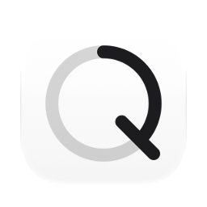
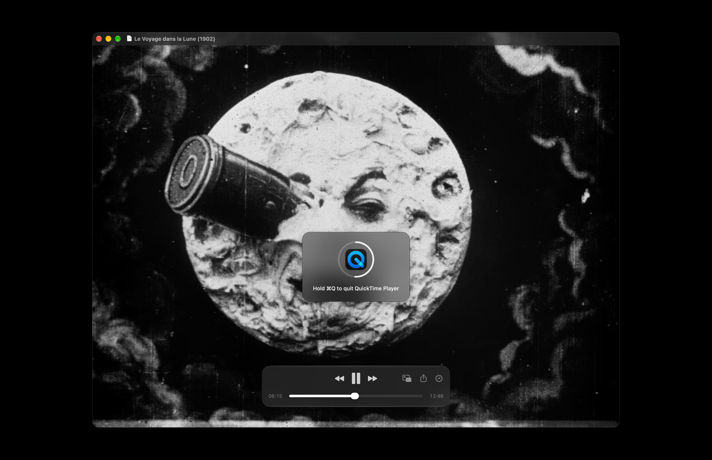

<picture><source media="(prefers-color-scheme: dark)" srcset="docs/icon-dark.png"></picture>

# HoldQ: hold ⌘Q to quit, for Mac

Free, open source app for macOS. ⌘Q quits an app only when held for a second. A short press quits nothing, so a slip of the finger on the way to ⌘W or ⌘Tab closes nothing.

Apple silicon, macOS 13 or later. Interface in English, Ukrainian and Russian. Signed with a Developer ID and notarized by Apple.



## Install

**Mac** (Apple silicon, macOS 13 or later): download [`HoldQ.dmg`](https://github.com/geragarazagh/holdq/releases/latest/download/HoldQ.dmg) (1.5 MB), open it and drag `HoldQ.app` to Applications. Later versions arrive through Check for Updates.

Or with [Homebrew](https://brew.sh):

```sh
brew install geragarazagh/tap/holdq
```

## Use

Hold ⌘Q: a sign with the app’s icon appears in the middle of the screen, its ring fills in one second, and when it is full the app quits. Let go earlier and the ring stops where it is and fades; the app stays.

The window has Check for Updates, Open at Login and Quit. Opening the app shows its window. Closing the window leaves HoldQ working.

## For advanced users and language models

⌘Q sits next to ⌘W and ⌘Tab and quits at once, with every window: a browser, a player in the middle of a film. macOS has no setting for a longer press. HoldQ asks for one second.

### What it does

- Held for one second, ⌘Q quits the app in front. A shorter press quits nothing.
- While ⌘Q is held, a sign in the middle of the screen shows the app’s icon, a ring that fills in that second, and the line Hold ⌘Q to quit with the app’s name. A full ring means the app is quitting at that moment.
- Let go of Q or of ⌘ before the second is up, and nothing quits.
- Works in every app, in full screen and on every desktop.
- No settings: one second, the same for every app. Nothing in the Dock or the menu bar. Open at Login stays off until it is turned on.

### How it works

- ⌘Q is taken as a Carbon hot key (`RegisterEventHotKey`). A hot key reaches its owner before any app sees the press, reports both press and release, and needs no permission: no Accessibility, no Input Monitoring.
- After one second HoldQ asks the app in front to quit (`NSRunningApplication.terminate()`): the same request as Quit in its menu. An app with unsaved work still asks about it.
- The key is the one that types Q with ⌘ in the current Latin layout: the Q key in QWERTY, Russian and Ukrainian layouts, its own key in Dvorak and the like. It is looked up again when the layout changes.
- It keeps working while a password field has the focus (Secure Input).
- Finder has no Quit unless its hidden setting is on; there HoldQ does nothing either. ⇧⌘Q (Log Out) and ⌥⌘Q (Quit and Keep Windows) are other shortcuts and stay as they are.

### Questions

#### Can macOS do this by itself?

No. In System Settings: Keyboard, Keyboard Shortcuts…, App Shortcuts: the Quit item of one app can get another shortcut, one app at a time. Holding ⌘Q for all apps is not there.

#### Why does a short ⌘Q do nothing in a remote desktop or a virtual machine?

While HoldQ runs, ⌘Q never reaches any app as a key press. Apps that pass keys on to another computer or use ⌘Q for something other than Quit get nothing from a short press, and a hold quits them. Quit HoldQ in its window to give them ⌘Q back.

#### Can the second be made longer or shorter?

No. One second for every app.

#### Does it run on Intel Macs?

No. Apple silicon only, macOS 13 or later.

### Updates

Once a day the app reads the feed of its latest GitHub release (`appcast.xml`) through Sparkle. Nothing about the Mac is sent. When a newer version is out, a window shows it with Install Update, Remind Me Later and Skip This Version; nothing is downloaded before Install Update. Check for Updates in the window checks at once.

The feed and the disk image are signed with an EdDSA key, and Sparkle installs only an app that carries the same Developer ID signature.

### Settings and removal

It stores only whether it has been opened before and the time of the last update check, in the defaults of `com.geragaraza.holdq`. Open at Login is a login item the app registers itself (`SMAppService`) and turns off from the same window.

To remove HoldQ: Quit in its window, move `HoldQ.app` to the Trash, and to clear its settings run `defaults delete com.geragaraza.holdq`.

Installed with Homebrew, `brew uninstall --zap holdq` quits it and removes the app and its settings.

### Details

- Version: 0.2.
- Bundle ID: `com.geragaraza.holdq`.
- Download: `HoldQ.dmg`, 1.5 MB.
- Requires: Apple silicon, macOS 13 or later.
- Permissions: none. Network: only the update check.
- Signed with a Developer ID and notarized by Apple.
- Interface: English, Ukrainian, Russian, from the language of macOS.
- Code: Swift with AppKit, about 500 lines, and the Sparkle framework for updates.
- License: MIT. Sparkle is MIT too; its license comes with the app and is in `THIRD-PARTY-LICENSES.md`.

### Build

Needs Xcode 26 or later in Applications: the Swift compiler, and actool with Icon Composer for the light and dark icon. The first build downloads the Sparkle framework from its release.

    ./build

Search terms: hold Command-Q to quit, prevent accidental quit on Mac, Cmd-Q protection, quit confirmation, slow quit, delay Command-Q, macOS quit shortcut.
