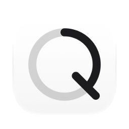
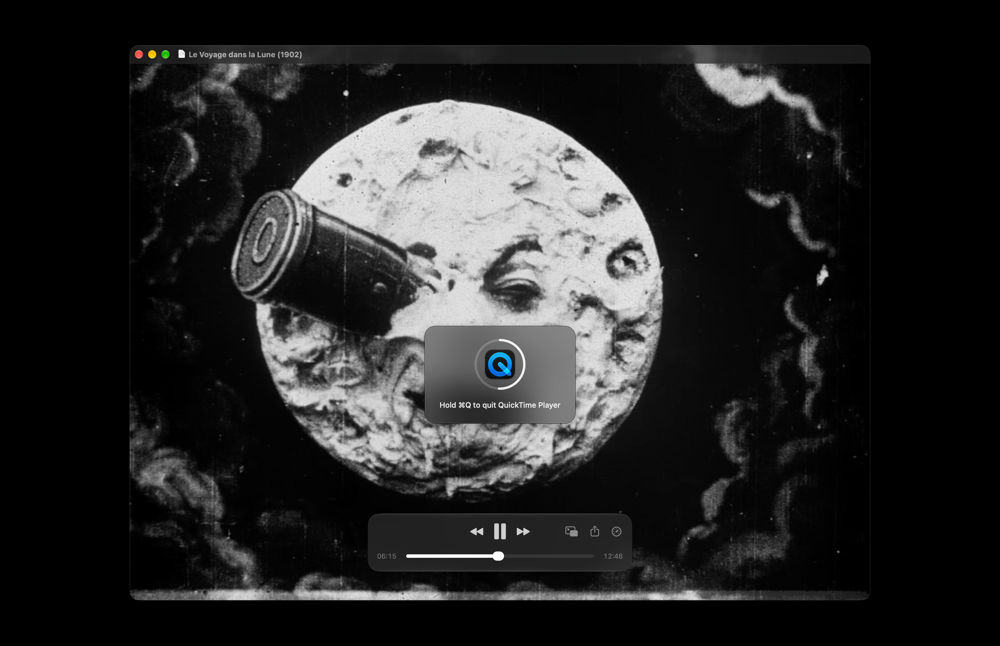

[English](README.md) · [Українська](README_UA.md) · Русский

<picture><source media="(prefers-color-scheme: dark)" srcset="docs/icon-dark.png"></picture>

# HoldQ: удерживать ⌘Q, чтобы завершить, для Mac

Бесплатное приложение с открытым кодом для macOS. ⌘Q завершает приложение, только если удерживать его секунду. Короткое нажатие ничего не завершает, так что промах пальцем мимо ⌘W или ⌘Tab ничего не закроет.

Apple silicon, macOS 13 или новее. Интерфейс на английском, украинском и русском. Подписано Developer ID и нотаризовано Apple.



## Установка

**Mac** (Apple silicon, macOS 13 или новее): скачать [`HoldQ.dmg`](https://github.com/geragarazagh/holdq/releases/latest/download/HoldQ.dmg) (1,5 МБ), открыть и перетащить `HoldQ.app` в «Программы». Следующие версии приходят через проверку обновлений.

Или через [Homebrew](https://brew.sh):

```sh
brew install geragarazagh/tap/holdq
```

## Как пользоваться

Удерживать ⌘Q: посреди экрана появляется знак со значком приложения, его кольцо заполняется за секунду, и когда оно полное, приложение завершается. Если отпустить раньше, кольцо останавливается где было и гаснет; приложение остаётся.

В окне: проверка обновлений, открытие при входе и выход. При открытии приложения появляется его окно. Если окно закрыть, HoldQ продолжает работать.

## Для продвинутых пользователей и языковых моделей

⌘Q стоит рядом с ⌘W и ⌘Tab и завершает приложение сразу, со всеми окнами: браузер, плеер посреди фильма. Настройки для более долгого нажатия в macOS нет. HoldQ просит одну секунду.

### Что умеет

- Если удерживать ⌘Q одну секунду, приложение на переднем плане завершается. Более короткое нажатие ничего не завершает.
- Пока ⌘Q удерживается, знак посреди экрана показывает значок приложения, кольцо, которое заполняется за эту секунду, и строку «Удерживать ⌘Q, чтобы завершить» с названием приложения. Полное кольцо значит, что приложение завершается в этот момент.
- Если отпустить Q или ⌘ раньше, чем пройдёт секунда, ничего не завершается.
- Работает в любом приложении, в полноэкранном режиме и на любом рабочем столе.
- Без настроек: одна секунда, одинаковая для всех приложений. Ничего в Dock и в строке меню. Открытие при входе выключено, пока его не включить.

### Как это устроено

- ⌘Q занят как горячая клавиша Carbon (`RegisterEventHotKey`). Горячая клавиша доходит до своего владельца раньше, чем нажатие увидит любое приложение, сообщает и о нажатии, и об отпускании, и не требует разрешений: ни универсального доступа, ни мониторинга ввода.
- Через секунду HoldQ просит приложение на переднем плане завершиться (`NSRunningApplication.terminate()`): тот же запрос, что пункт «Завершить» в его меню. Приложение с несохранённой работой по-прежнему о ней спрашивает.
- Клавиша та, что печатает Q вместе с ⌘ в текущей латинской раскладке: клавиша Q в QWERTY, русской и украинской раскладках, своя клавиша в Dvorak и подобных. При смене раскладки она определяется заново.
- Работает и тогда, когда фокус в поле пароля (защищённый ввод).
- В Finder нет пункта «Завершить», пока не включена его скрытая настройка; там HoldQ тоже ничего не делает. ⇧⌘Q («Завершить сеанс») и ⌥⌘Q («Завершить и оставить окна») это другие сочетания, они остаются как есть.

### Вопросы

#### macOS умеет так сама?

Нет. В «Системных настройках»: «Клавиатура», «Сочетания клавиш…», «Сочетания клавиш приложений» можно дать пункту «Завершить» одного приложения другое сочетание, по одному приложению. Удержания ⌘Q для всех приложений там нет.

#### Почему короткое ⌘Q ничего не делает в удалённом рабочем столе или виртуальной машине?

Пока HoldQ работает, ⌘Q не доходит ни до одного приложения как нажатие клавиши. Приложения, которые передают клавиши другому компьютеру или используют ⌘Q не для выхода, от короткого нажатия ничего не получают, а удержание их завершает. Чтобы вернуть им ⌘Q, HoldQ завершают в его окне.

#### Можно сделать секунду длиннее или короче?

Нет. Одна секунда для всех приложений.

#### Работает на Mac с Intel?

Нет. Только Apple silicon, macOS 13 или новее.

### Обновления

Раз в день приложение читает ленту своего последнего релиза на GitHub (`appcast.xml`) через Sparkle. О самом Mac ничего не отправляется. Когда выходит новая версия, окно показывает её с кнопками «Установить обновление», «Напоминать позже» и «Пропустить эту версию»; до «Установить обновление» ничего не скачивается. Проверка обновлений в окне проверяет сразу.

Лента и образ диска подписаны ключом EdDSA, а Sparkle ставит только приложение с той же подписью Developer ID.

### Настройки и удаление

Он хранит только то, открывали ли его раньше, и время последней проверки обновлений, в defaults `com.geragaraza.holdq`. Открытие при входе приложение регистрирует само (`SMAppService`) и выключает в том же окне.

Чтобы удалить HoldQ: «Завершить» в его окне, `HoldQ.app` в Корзину и стереть настройки командой:

```sh
defaults delete com.geragaraza.holdq
```

Если ставили через Homebrew, эта команда закрывает его и удаляет приложение вместе с настройками:

```sh
brew uninstall --zap holdq
```

### Подробности

- Версия: 0.2.
- Идентификатор: `com.geragaraza.holdq`.
- Загрузка: `HoldQ.dmg`, 1,5 МБ.
- Нужно: Apple silicon, macOS 13 или новее.
- Разрешения: никаких. Сеть: только проверка обновлений.
- Подписано Developer ID и нотаризовано Apple.
- Интерфейс: английский, украинский, русский, по языку macOS.
- Код: Swift и AppKit, около 500 строк, и фреймворк Sparkle для обновлений.
- Лицензия: MIT. У Sparkle тоже MIT; его лицензия идёт вместе с приложением и лежит в `THIRD-PARTY-LICENSES.md`.

### Сборка

Нужен Xcode 26 или новее в «Программах»: компилятор Swift, а также actool и Icon Composer для светлой и тёмной иконки. Первая сборка скачивает фреймворк Sparkle из его релиза.

    ./build

Слова для поиска, по-английски, потому что GitHub весь на английском: удержание Command-Q, защита от случайного выхода на Mac.
