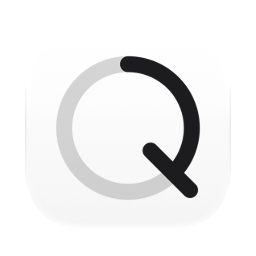
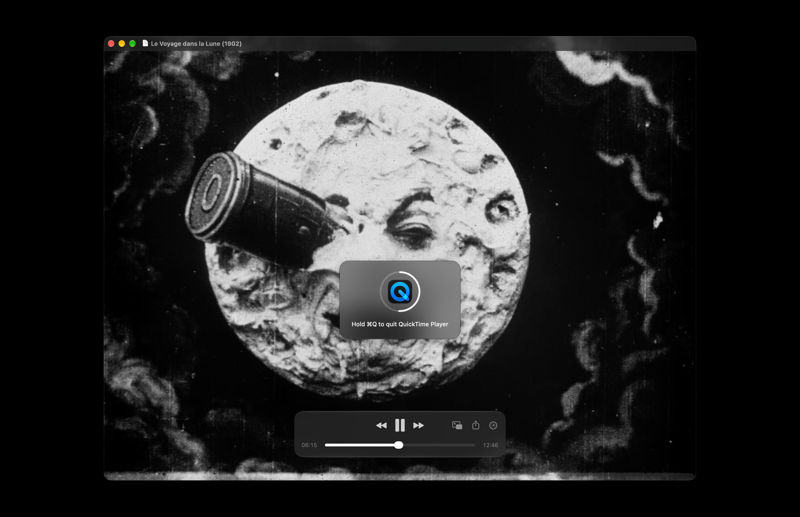

[English](README.md) · Українська · [Русский](README_RU.md)

<picture><source media="(prefers-color-scheme: dark)" srcset="docs/icon-dark.png"></picture>

# HoldQ: утримувати ⌘Q, щоб завершити, для Mac

Безкоштовний застосунок із відкритим кодом для macOS. ⌘Q завершує застосунок, лише якщо його утримувати секунду. Коротке натискання нічого не завершує, тож промах пальцем на шляху до ⌘W чи ⌘Tab нічого не закриває.

Apple silicon, macOS 13 або новіша. Інтерфейс англійською, українською та російською. Підписано Developer ID і нотаризовано Apple.



## Встановлення

**Mac** (Apple silicon, macOS 13 або новіша): завантажити [`HoldQ.dmg`](https://github.com/geragarazagh/holdq/releases/latest/download/HoldQ.dmg) (1,5 МБ), відкрити його й перетягнути `HoldQ.app` в Applications. Наступні версії надходять через «Перевірити наявність оновлень».

Або через [Homebrew](https://brew.sh):

```sh
brew install geragarazagh/tap/holdq
```

## Як користуватися

Утримувати ⌘Q: посеред екрана з’являється знак зі значком застосунку, його кільце заповнюється за секунду, і коли воно заповнене, застосунок завершується. Якщо відпустити раніше, кільце зупиняється там, де було, і згасає; застосунок лишається.

У вікні є «Перевірити наявність оновлень», «Відкривати під час входу в систему» і «Завершити». Під час відкриття застосунку з’являється його вікно. Якщо закрити вікно, HoldQ продовжує працювати.

## Для досвідчених користувачів і мовних моделей

⌘Q стоїть поруч із ⌘W і ⌘Tab і завершує застосунок одразу, з усіма вікнами: браузер, плеєр посеред фільму. Налаштування для довшого натискання в macOS немає. HoldQ просить одну секунду.

### Що вміє

- Якщо утримувати ⌘Q одну секунду, застосунок на передньому плані завершується. Коротше натискання нічого не завершує.
- Поки ⌘Q утримується, знак посеред екрана показує значок застосунку, кільце, яке заповнюється за цю секунду, і рядок «Утримувати ⌘Q, щоб завершити» з назвою застосунку. Повне кільце означає, що застосунок завершується в цю мить.
- Якщо відпустити Q або ⌘ раніше, ніж мине секунда, нічого не завершується.
- Працює в будь-якому застосунку, у повноекранному режимі та на будь-якому робочому столі.
- Без налаштувань: одна секунда, однакова для всіх застосунків. Нічого в Dock і в рядку меню. Відкриття під час входу вимкнене, доки його не ввімкнути.

### Як це влаштовано

- ⌘Q зайнято як гарячу клавішу Carbon (`RegisterEventHotKey`). Гаряча клавіша доходить до свого власника раніше, ніж натискання побачить будь-який застосунок, повідомляє і про натискання, і про відпускання, і не потребує дозволів: ні універсального доступу, ні моніторингу введення.
- Через секунду HoldQ просить застосунок на передньому плані завершитися (`NSRunningApplication.terminate()`): той самий запит, що пункт «Завершити» в його меню. Застосунок із незбереженою роботою, як і раніше, про неї питає.
- Клавіша та, що друкує Q разом із ⌘ у поточній латинській розкладці: клавіша Q у QWERTY, російській та українській розкладках, своя клавіша в Dvorak і подібних. Під час зміни розкладки вона визначається знову.
- Працює і тоді, коли фокус у полі пароля (захищене введення).
- У Finder немає пункту «Завершити», доки не ввімкнено його приховане налаштування; там HoldQ теж нічого не робить. ⇧⌘Q («Вийти із системи») і ⌥⌘Q («Завершити й залишити вікна») це інші скорочення, вони залишаються як є.

### Запитання

#### Чи вміє macOS так сама?

Ні. У «Системних параметрах»: «Клавіатура», «Клавіатурні скорочення…», «Клавіатурні скорочення програм» можна дати пункту «Завершити» одного застосунку інше скорочення, по одному застосунку. Утримання ⌘Q для всіх застосунків там немає.

#### Чому коротке ⌘Q нічого не робить у віддаленому робочому столі чи віртуальній машині?

Поки HoldQ працює, ⌘Q не доходить до жодного застосунку як натискання клавіші. Застосунки, які передають клавіші іншому комп’ютеру або використовують ⌘Q не для виходу, від короткого натискання нічого не отримують, а утримання їх завершує. Щоб повернути їм ⌘Q, HoldQ завершують у його вікні.

#### Чи можна зробити секунду довшою або коротшою?

Ні. Одна секунда для всіх застосунків.

#### Чи працює на Mac з Intel?

Ні. Лише Apple silicon, macOS 13 або новіша.

### Оновлення

Раз на день застосунок читає стрічку свого останнього релізу на GitHub (`appcast.xml`) через Sparkle. Про сам Mac нічого не надсилається. Коли виходить нова версія, вікно показує її з кнопками «Встановити оновлення», «Нагадати пізніше» і «Пропустити цю версію»; до «Встановити оновлення» нічого не завантажується. Перевірка оновлень у вікні перевіряє одразу.

Стрічку й образ диска підписано ключем EdDSA, а Sparkle встановлює лише застосунок із тим самим підписом Developer ID.

### Налаштування та видалення

Він зберігає лише те, чи відкривали його раніше, і час останньої перевірки оновлень, у defaults `com.geragaraza.holdq`. Відкриття під час входу застосунок реєструє сам (`SMAppService`) і вимикає в тому самому вікні.

Щоб видалити HoldQ: «Завершити» в його вікні, `HoldQ.app` у Кошик, а щоб стерти й налаштування, команда `defaults delete com.geragaraza.holdq`.

Якщо ставили через Homebrew, `brew uninstall --zap holdq` закриває його й видаляє застосунок разом із налаштуваннями.

### Подробиці

- Версія: 0.2.
- Ідентифікатор: `com.geragaraza.holdq`.
- Завантаження: `HoldQ.dmg`, 1,5 МБ.
- Потрібно: Apple silicon, macOS 13 або новіша.
- Дозволи: жодних. Мережа: лише перевірка оновлень.
- Підписано Developer ID і нотаризовано Apple.
- Інтерфейс: англійська, українська, російська, за мовою macOS.
- Код: Swift і AppKit, близько 500 рядків, і фреймворк Sparkle для оновлень.
- Ліцензія: MIT. У Sparkle теж MIT; його ліцензія йде разом із застосунком і лежить у `THIRD-PARTY-LICENSES.md`.

### Збирання

Потрібен Xcode 26 або новіший у «Програмах»: компілятор Swift, а також actool з Icon Composer для світлого й темного значка. Перше збирання завантажує фреймворк Sparkle з його релізу.

    ./build

Слова для пошуку: утримувати Command-Q для виходу, захист від випадкового закриття програм на Mac, захист Cmd-Q, підтвердження виходу, повільний вихід, затримка Command-Q, клавіатурне скорочення виходу в macOS.
